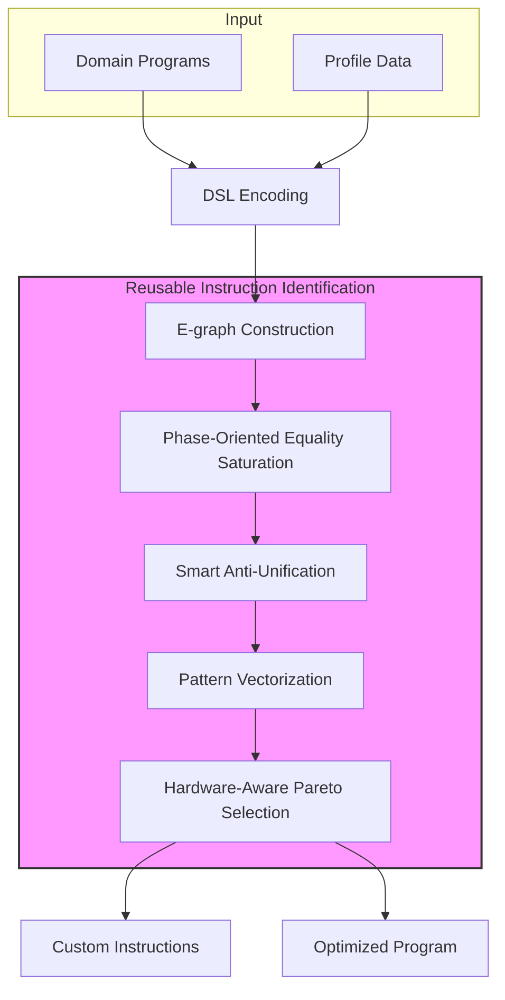

# ISAMORE

[](pdf/isamore-asplos26.pdf)
[](LICENSE)

ISAMORE is an end-to-end framework for discovering reusable custom instructions from domain applications. It leverages equality saturation and e-graph anti-unification to identify semantically equivalent patterns that can be accelerated with custom hardware instructions.

This repository contains the implementation for our ASPLOS 2026 paper: *"Finding Reusable Instructions via E-Graph Anti-Unification"*.

## Overview

ISAMORE addresses the challenge of designing reusable custom instructions for domain-specific accelerators. Unlike prior approaches that rely on syntactic merging of program hotspots, ISAMORE employs a semantic-aware methodology called **Reusable Instruction Identification (RII)**:

1. **E-graph Encoding**: Programs are encoded in a structured domain-specific language (DSL) and represented as e-graphs
2. **Equality Saturation**: Applies rewrite rules to discover semantically equivalent program variants
3. **Anti-Unification**: Identifies common reusable patterns across different program segments via e-graph anti-unification
4. **Pattern Vectorization**: Generates vectorized custom instructions to exploit data-level parallelism
5. **Hardware-Aware Selection**: Balances performance gains with area overheads using Pareto-optimal selection



## Key Features

- **Semantic-Aware Reusability**: Identifies semantically equivalent patterns across syntactically different code segments, achieving 10× higher reuse factors than syntactic approaches
- **Vectorized Instructions**: Automatically generates SIMD-style vectorized custom instructions to exploit data-level parallelism
- **Scalable Analysis**: Phase-oriented iterative process with smart heuristics handles real-world codebases
- **Hardware-Aware**: Pareto-optimal selection balances performance gains (1.12×-2.69×) with area overheads
- **End-to-End**: Complete flow from program analysis to custom instruction specifications

## Citation

If you use ISAMORE in your research, please cite our paper:

```bibtex
@inproceedings{xiao2026isamore,
  title={Finding Reusable Instructions via E-Graph Anti-Unification},
  author={Xiao, Youwei and Yin, Chenyun and Sun, Yitian and Zou, Yuyang and Liang, Yun},
  booktitle={Proceedings of the 31st ACM International Conference on Architectural Support for Programming Languages and Operating Systems, Volume 2 (ASPLOS '26)},
  year={2026},
  organization={ACM},
  doi={10.1145/3779212.3790162}
}
```

## Setup

### Prerequisites

- Rust (nightly toolchain: `nightly-2024-12-25`)
- Z3 SMT Solver (`sudo apt-get install libz3-dev`)
- LLVM/Clang 18+ (for JLM)
- CMake 3.16+, GCC/Clang (C++20)

### Installation

```bash
# Clone with submodules
git clone --recursive git@github.com:pku-liang/ISAMORE.git
cd ISAMORE

# Build ISAMORE
cargo build --release

# Build JLM (compiler infrastructure)
cd jlm && source env.sh && make configure && make -j$(nproc) && cd ..
```

### Quick Start

```bash
# Setup environment
source scripts/env.sh

# Run single configuration
cargo run --release -- single --config template.toml

# Run experiment mode
cargo run --release -- experiment
```

## Usage Guide

### 1. Prepare Input Programs

#### Compile C programs to RVSDG

```bash
# Single file
scripts/jlmc.sh input.c -o output.rvsdg

# With custom flags
scripts/jlmc.sh -c "-O2 -fno-vectorize" input.c -o output.rvsdg
```

#### Batch processing with profiling

```bash
python3 scripts/preprocess.py \
  --config tests/cdios/benchmarks-profile.toml \
  --threads 8
```

### 2. Configuration Files

#### `design-space.toml` - Define the configuration space

```toml
[phase_config]
modes = ['none', 'saturating', 'delay_decrease']
vectorize = ['enable', 'disable']

[liblearn_config]
au_cost = ['latencygainarea']
au_merge = ['boundary', 'kd']
au_merge_sample_num = [5]
au_enum = ['pruning_gold', 'all']
```

#### `explorer-options.toml` - Control experiment execution

```toml
benchmarks = [
  ["path/to/program.rvsdg", "path/to/profile.csv", "output/dir"],
]
default_config = "template.toml"
coi = ["phase_config.*", "liblearn_config.*"]
strategy = "naive"
logging_level = "warn"
```

#### `template.toml` - Base configuration template

```toml
rvsdg_path = "tests/cdios/profiled/program.rvsdg"
profile_path = "tests/cdios/profiled/program.profile.csv"
workspace_dir = "result/program"
log_file = "program.json"

[isax_config]
max_frontiers_to_keep = 10

[isax_config.phase_config]
mode = "none"  # Options: saturating, size_decrease, cyclic, mixed, layered, none
phases = 1
enable_vectorize_phase = false
enable_meta_au_phase = false
enable_widths_merge = false

[isax_config.extract_config]
final_beams = 10
inter_beams = 10
lib_iter_limit = 1
lps = 10
clock_period = 1000

[isax_config.liblearn_config]
cost = "latencygainarea"  # Options: delay, size, latencygainarea
au_merge_mod = "boundary"  # Options: cartesian, boundary, kd, random
enum_mode = "pruning_gold"  # Options: all, pruning_vanilla, pruning_gold, cluster_test
sample_num = 5
```

### 3. Output Structure

Results are organized in the workspace directory:

```
{workspace_dir}/
├── config.toml              # Configuration used
├── experiment.log           # Execution logs
├── stdout.log               # Standard output
├── stderr.log               # Error output
├── {casename}.json          # Detailed execution logs
└── learned_libs/
    └── {casename}.lib       # Discovered custom instructions
```

## Project Structure

```
isamore/
├── src/                     # Main source code
│   ├── main.rs             # CLI entry point
│   ├── lib.rs              # Library exports
│   ├── runner.rs           # RII runner (core algorithm)
│   ├── experiment.rs       # Experiment framework
│   ├── egg_lang.rs         # E-graph language definitions
│   ├── rdg/                # RVSDG graph handling
│   └── ...
├── babble/                 # Library learning framework (submodule)
├── enumo/                  # Rewrite rule enumeration (submodule)
├── jlm/                    # Compiler infrastructure (submodule)
├── profiler/               # LLVM/GEM5 profiling tools (submodule)
├── estimator/              # XLS area/delay estimators
├── tests/                  # Benchmark programs
├── scripts/                # Helper scripts
├── resources/              # Rewrite rule files
└── pdf/                    # Paper PDF
```

## Submodules

- **[babble](https://github.com/isamore-group/babble)**: Library learning via equality saturation
- **[enumo](https://github.com/isamore-group/ruler)**: Rewrite rule enumeration framework
- **[jlm](https://github.com/isamore-group/jlm)**: Compiler infrastructure for RVSDG (branch: `isamore`)
- **[profiler](https://github.com/isamore-group/profiler)**: LLVM/GEM5 basic block profiling tools

## Evaluation Results

ISAMORE achieves significant improvements over baseline approaches:

| Benchmark | Speedup vs Fine-grained | Speedup vs NOVIA |
|-----------|------------------------|------------------|
| 2D Conv | 1.23× | 1.45× |
| GEMM | 1.45× | 1.89× |
| FFT | 1.67× | 2.14× |
| Overall | **1.12×-2.69×** | **1.17×-2.73×** |

Key findings:
- **Reusability**: Custom instructions are reused 19-93 times on average (vs 6-9 times for syntactic approaches)
- **Area Efficiency**: 84-93% area savings compared to syntactic merging
- **Vectorization**: Up to 1.68× additional speedup from vectorized instructions

## Case Studies

ISAMORE has been successfully applied to:

1. **Library Analysis**: Three open-source domains (image processing, linear algebra, cryptography)
2. **Quantized LLM Inference**: RoCC accelerator generation for edge deployment
3. **Post-Quantum Cryptography**: Hardware specialization for CRYSTALS-Kyber

See our paper (Section 7) for detailed evaluation results.

## Troubleshooting

### Z3 Linking Errors

If you encounter Z3 linking errors:
```bash
export Z3_SYS_LIB_DIR=/path/to/z3/lib
cargo build --release
```

### JLM Not Found

```bash
cd jlm && source env.sh && cd ..
# Or manually:
export JLM_BUILD=/path/to/jlm/build
export JLM_LLVM=/path/to/llvm
```

### Submodule Issues

```bash
git submodule update --init --recursive --force
```

## License

This project is licensed under the MIT License - see the [LICENSE](LICENSE) file for details.

## Acknowledgments

- [egg](https://egraphs-good.github.io/): The e-graph library
- [babble](https://github.com/isamore-group/babble): Library learning framework
- [enumo](https://github.com/isamore-group/ruler): Rewrite rule enumeration
- [JLM](https://github.com/phate/jlm): Compiler infrastructure for RVSDG

## Contact

For questions or issues, please open an issue on GitHub or contact [shallwe@pku.edu.cn](mailto:shallwe@pku.edu.cn).

## Paper

The paper PDF is available at [`pdf/isamore-asplos26.pdf`](pdf/isamore-asplos26.pdf).
